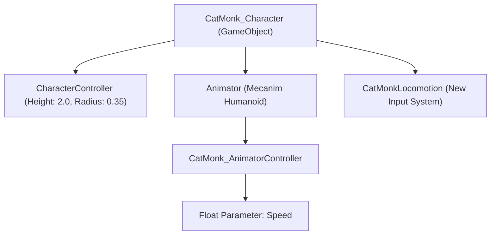

# 🐾 Character Sheet: Cat Monk / Assassin

> **Entity ID**: `CatMonk_Character`  
> **Source Model**: `CatMonk_Humanoid.fbx`  
> **Mecanim Avatar**: Humanoid (`AvatarSetup: CreateFromThisModel`)  
> **Primary Role**: Agile Martial Artist / Silent Assassin

---

## 1. Physical Specifications & Anatomy

| Metric | Dimension / Value | Rationale |
| :--- | :--- | :--- |
| **Height** | $1.95\text{ m}$ (including ears) | Hero scale; clearly readable in third-person camera. |
| **Width (Shoulders)** | $0.68\text{ m}$ | Lean, athletic martial frame. |
| **Weight Distribution** | Low center-of-gravity | Emphasizes beastkin feline agility. |
| **Tail Dimension** | $0.55\text{ m}$ | Acts as kinetic counter-weight during leaps and pivots. |
| **Ears** | Triangular pointed ($0.20\text{ m}$) | Expressive audio-visual cue for alertness and mood. |

---

## 2. Animation & Stance Vocabulary

### 2.1 Natural Standing Idle (`OneHand_Up_Idle`)
* **Posture**: Upright humanoid stance with feet shoulder-width apart.
* **Respiration**: Subtle vertical chest bob ($0.02\text{ m}$ amplitude).
* **Feline Accent**: Periodic tail counter-curl and ear twitch.

### 2.2 Stealth Walk / Stalk (`OneHand_Up_Walk_F_InPlace`)
* **Posture**: Low crouch-stalk with knees bent ($30^\circ\text{--}45^\circ$).
* **Arm Carriage**: Relaxed martial guard, claws ready.
* **Footwork**: Soft toe-strike stepping to minimize audio signature.

### 2.3 Ninja Sprint / Dash (`OneHand_Up_Run_F_InPlace`)
* **Posture**: Deep $20^\circ$ forward torso pitch.
* **Limb Motion**: High-stride extension, vigorous counter-balancing arm pumps.
* **Tail**: Streamlined horizontal orientation for aerodynamic stability.

---

## 3. Unity Component Architecture

---

## 4. Next Iterations (Combat & Ability Expansion)
- [ ] Jump / Acrobatic Wall Leap (`Jump_B`).
- [ ] Light Paw Strike combo (3-hit punch/claw chain).
- [ ] Tail Sweep crowd control knockdown.
- [ ] Shadow Step teleport / blink dodge.
