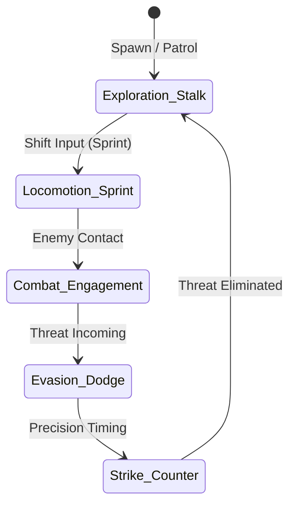

# 📜 Game Design Document (GDD): Project Ironforge

> **Status**: Active Prototyping  
> **Target Engine**: Unity 6 (Universal Render Pipeline - URP)  
> **Genre**: Third-Person Action / Agile Combat  
> **Core Focus**: High-mobility martial arts, fluid bipedal beastkin traversal, and tactical responsiveness.

---

## 1. Executive Summary & Vision

Project Ironforge centers on an athletic, agile beastkin monk/assassin traversing stylized environments with acrobatic speed and fluid martial arts combat.

### Core Pillars
1. **Flow-State Locomotion**: Instantaneous momentum shifts between stealth stalk, alert walk, high-stride sprint, and vertical traversal.
2. **Kinetic Weight & Physicality**: Low ground-contact slip, realistic weight transfers, and impactful physical animations.
3. **Agile Martial Finesse**: Precision timing, dodging, and swift counter-attacks over sluggish heavy brawling.

---

## 2. Core Game Loop

---

## 3. Playable Character: The Cat Monk

Detailed breakdown available in [[01_Game_Design/Character_Cat_Monk|Character Sheet: Cat Monk]].

* **Species**: Feline Beastkin (Tabaxi / Felyne martial artist).
* **Archetype**: Shadow Monk / Assassin.
* **Silhouette**:
  * Lean, athletic bipedal frame.
  * Expressive feline features (pointy ears, alert whiskers/snout, counter-balancing tail).
  * Low, ground-hugging ready stances transitioning into upright martial poses.

---

## 4. Locomotion & Physics Specifications

Detailed breakdown available in [[01_Game_Design/Combat_and_Locomotion|Combat & Locomotion System]].

* **Movement Speeds**:
  * **Idle**: 0.0 m/s (Breathing, counter-weighted tail twitch, alert posture).
  * **Walk / Stalk**: 2.5 m/s (Stealthy feline pacing).
  * **Sprint / Dash**: 5.5 m/s (Athletic forward-leaning ninja dash).
* **Turning Rate**: $720^\circ/\text{sec}$ smooth angular interpolation (`Mathf.MoveTowardsAngle`).
* **Input Architecture**:
  * Unity New Input System (`UnityEngine.InputSystem`).
  * Direct stick/keyboard vector normalization to prevent diagonal speed boosting.

---

## 5. Visual Style & Art Direction

* **Rendering Pipeline**: Universal Render Pipeline (URP).
* **Shading**: Clean stylized PBR (Subtle roughness maps, crisp normal accents, and saturated character silhouettes).
* **Environment**: High-contrast training dojos, stone courtyards, wooden obstacle pillars, and elevated training platforms.
