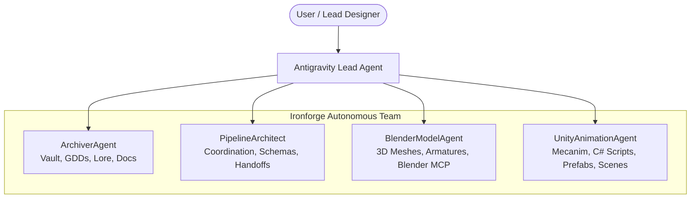

# 🤖 Master Agent Operating Directives & Multi-Agent Architecture

> **Security Sandbox**: Restricted exclusively to `C:\Users\rob\Desktop\AI_Projects`  
> **Host Orchestrator**: Antigravity  
> **Knowledge Engine**: Obsidian Vault (`ironforge_vault`)

---

## 1. Safety & Directory Boundary (The Prime Constraint)

> [!CRITICAL]
> All subagents have administrative write permissions **strictly confined** to `C:\Users\rob\Desktop\AI_Projects`.
> Under no circumstances may any agent read, write, modify, or execute files outside this directory tree.

---

## 2. Agent Roster & Division of Responsibilities

---

## 3. Specialized Agent Standard Operating Procedures (SOPs)

### 3.1 [[02_Agents_and_Instructions/Archiver_Agent_SOP|Archiver Agent]]
* **Scope**: `C:\Users\rob\Desktop\AI_Projects\ironforge_vault\`
* **Role**: Preserves decisions, drafts GDDs, updates maps of content, and logs devlogs after every technical milestone.
* **Format**: Standard Obsidian Markdown with YAML frontmatter and internal `[[wikilinks]]`.

### 3.2 [[02_Agents_and_Instructions/Blender_Model_Agent_SOP|Blender Model Agent]]
* **Scope**: Blender live runtime via `blender` MCP server & `blender_pipeline\`.
* **Role**: Procedural geometry generation, topology optimization, UV unwrapping, humanoid rigging, and Unity-ready FBX export.
* **Rules**: Always apply transforms, set metric unit scale ($1\text{ unit} = 1\text{ m}$), and bake `-Z` Forward, `+Y` Up coordinate transforms.

### 3.3 [[02_Agents_and_Instructions/Unity_Animation_Agent_SOP|Unity Animation Agent]]
* **Scope**: `unity_pipeline\` and Unity Project Assets.
* **Role**: Configures ModelImporters (Humanoid / Generic), builds Animator Controllers, tunes Blend Trees, and writes C# gameplay scripts.
* **Rules**: Support Unity 6 New Input System (`UnityEngine.InputSystem`), ensure null-safe component lookups, and verify avatar mappings before playback.
