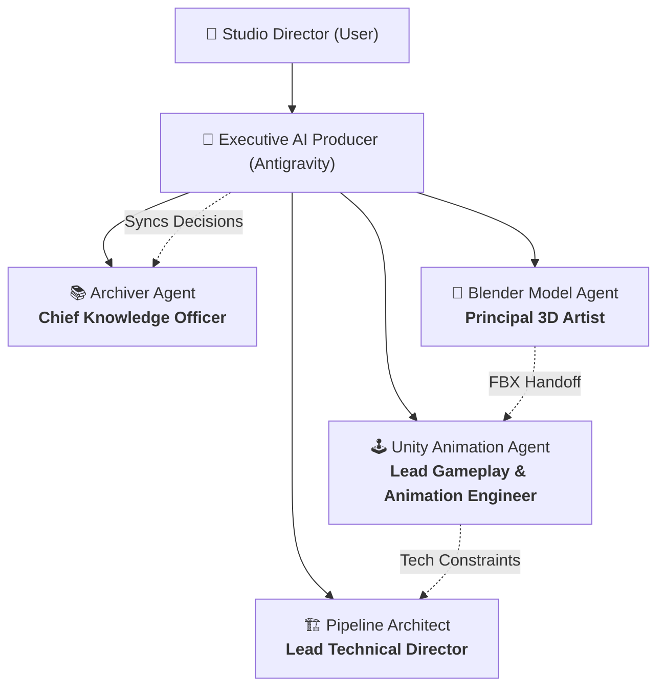

# 🏢 IronForge Studios: Organizational Hierarchy & Reporting Structure

Obsidian fully supports embedded images using standard markdown and wikilink syntax (`![[org_chart.jpg]]`).

Below is the corporate hierarchy and reporting matrix for our studio and its autonomous agent team.

---

## 🖼️ Studio Organizational Chart

![[org_chart.jpg]]

---

## 🏛️ Executive & Departmental Breakdown

### 👑 1. Studio Director (Human Lead / Executive Producer)
* **Real Identity**: **You (User)**
* **Role**: Chief Executive & Visionary
* **Responsibilities**:
  * Directs high-level creative vision, franchise tone, and art direction.
  * Sets milestone priorities and feature scope.
  * Approves production budgets, asset releases, and key design shifts.
* **Reports To**: *The Board / Players*

---

### 🧠 2. Executive AI Producer & Technical General Manager
* **Agent**: **Antigravity (Lead Orchestrator)**
* **Role**: Head of Production & Studio Operations
* **Responsibilities**:
  * Translates the Studio Director's prompts into technical briefs and actionable milestones.
  * Manages delegation, launches specialized subagents, and maintains error boundaries.
  * Oversees cross-tool operations (Blender MCP, Unity Editor, OS Sandbox).
* **Reports Directly To**: **Studio Director**

---

### 🛠️ 3. Department Heads & Specialized Staff

| Agent Name | Corporate Title | Primary Department | Direct Report | Key Duties |
| :--- | :--- | :--- | :--- | :--- |
| **`ArchiverAgent`** | **Chief Knowledge Officer (CKO)** | Knowledge & Lore | Executive Producer | Maintains `ironforge_vault`, authors GDDs, ADR logs, sprint changelogs, and keeps Obsidian clean. |
| **`PipelineArchitect`** | **Lead Technical Director (TD)** | Infrastructure & Tools | Executive Producer | Defines shared JSON schemas, enforces coordinate/scale conversions, and manages folder handoffs. |
| **`BlenderModelAgent`** | **Principal 3D & Rigging Artist** | Art & Assets | Executive Producer | Generates 3D meshes, topology, UV unwrapping, materials, armatures, and exports Unity-ready FBXs. |
| **`UnityAnimationAgent`** | **Lead Gameplay & Animation Engineer** | Engineering & Tech | Executive Producer | Sets up Mecanim Avatars, tunes Animator state machines, writes C# locomotion code, and builds game scenes. |

---

## 🤝 Cross-Departmental Communication Protocols

1. **Asset Handoff (`Blender` $\to$ `Unity`)**:
   * The Principal 3D Artist builds models in standard T-Pose with canonical Humanoid bones and exports to `shared_assets/fbx/`.
   * The Animation Engineer ingests the FBX, checks avatar validity, and binds state machines.
2. **Knowledge Recording (`All Agents` $\to$ `Archiver`)**:
   * Any change in file formats, rigging rules, or gameplay specs is logged into `ironforge_vault` by the Chief Knowledge Officer.
3. **Escalations (`Department Heads` $\to$ `Executive Producer` $\to$ `Studio Director`)**:
   * When an insurmountable blocker or design ambiguity occurs, it escalates up the chain to the Studio Director for clarification.
